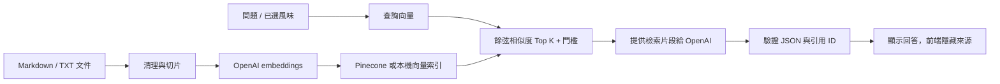

# 鱸魚精風味設計與 RAG 知識問答

本專案用於作品展示，下載後在本機執行，不提供公開線上服務。每位使用者需自行填入 API 金鑰；GitHub 與分享版不含作者的金鑰或私人設定。Windows 雙擊啟動與可攜版建置方式見 [DEMO.md](DEMO.md)。

原有的拖曳風味體驗，接上可匯入文件、持久化向量索引、實際檢索、OpenAI 生成與來源引用的 RAG 流程。

本版支援 **OpenAI + Pinecone 雲端向量資料庫**，並保留舊的本機 JSON 模式供遷移與離線測試。Pinecone 設定、免重算向量遷移與真實驗證請先看 [PINECONE.md](PINECONE.md)。`RAG_STORE=pinecone` 使用雲端檢索；`local` 使用原本機索引。沒有金鑰時可以開啟網站及執行離線測試，但不會假裝已生成 AI 回答。

目前前端隱藏引用編號、按鈕與來源展開區塊，以維持閱讀版面；後端的來源驗證、API `sources` 與知識文件中的出處仍保留，便於維護者查核。

設計報告不顯示「下一步推薦風味」。三個報告區塊首次成功取得後，依身份與配方（含重複成分的比例）保存在該瀏覽器來源的 localStorage；返回或重新整理沿用原結果，配方／身份改變後才重新生成，失敗區塊可在重訪時重試。清除網站儲存資料或更換本機連接埠會需要重新生成。分享頁不再發出 RAG 查詢。

GitHub 儲存庫用來保存程式、公開知識文件與安裝說明，並不會自動執行後端。`.env`、`.data/` 已忽略；新機器下載後需自行設定金鑰，執行 `npm ci --ignore-scripts`、`npm run ingest`、`npm start`。本機索引可搬到伺服器使用，但正式公開服務仍需部署後端、設定持久化資料目錄及存取控制，不能只靠 GitHub Pages 執行本專案。

## 快速啟動（Windows PowerShell）

需要 Node.js 22.14 以上。在下載並解壓的專案根目錄開啟終端機。以下是本機 JSON 模式流程；使用 Pinecone 時請依 [PINECONE.md](PINECONE.md) 的「新機器或更新文件」設定並匯入，不需要安裝額外資料庫，也不需要作者的 index.json。

```powershell
npm.cmd ci --ignore-scripts
Copy-Item .env.example .env
```

如果已經有 `.env`，請保留原檔，不要覆寫。以文字編輯器在本機填入 `OPENAI_API_KEY`，不要把值貼到聊天、前端或 Git。

```powershell
# 只檢查文件與切片，不呼叫 API
npm.cmd run ingest -- --dry-run

# 實際呼叫 OpenAI 建立向量索引
npm.cmd run ingest

# 啟動網站，只監聽本機
npm.cmd start
```

- 風味設計：http://127.0.0.1:3000/
- 文件問答：http://127.0.0.1:3000/rag.html
- 設定／索引狀態：http://127.0.0.1:3000/api/health

`.env` 也可放在其他本機位置；啟動前設定 `$env:RAG_ENV_FILE = '設定檔完整路徑'`。此變數只存路徑。不要在網址、命令參數或前端填入金鑰。

## RAG 如何運作



預設嵌入模型 `text-embedding-3-small`，生成模型 `gpt-4o-mini`。原專案使用的 `text-embedding-ada-002` 向量未被沿用，全部重新建立。

文件以最多 700 字元切片，保留約 100 字元重疊；檢索預設取最多 5 片，相似度門檻 0.30。模型名稱、文件指紋、維度都記在索引裡；文件或嵌入模型變更後，服務要求重新匯入，避免混用不相容向量。本機模式以原子替換檔案保留上一份有效索引；Pinecone 使用文件版本 namespace 隔離，舊版本保留但不參與新查詢，需自行管理舊版本容量。

生成採用 JSON Schema，模型只能引用本次檢索到的來源 ID。回覆缺少引用、引用不存在、格式錯誤或生成中斷會回報錯誤。相似度不足時不呼叫生成模型；檢索到文件但無法回答時，要求模型明確表示資料不足。

引用驗證能檢查來源是否存在，**不能自動證明每句話都正確地受到來源支持**。模型回答仍需對照原文，尤其不應把此風味資料作為醫療或營養依據。

## 知識資料

`knowledge/demo/` 包含 30 份知識文件：

- 12 種可拖曳風味：檸檬、蜂蜜、薑汁、薰衣草、薄荷、香草、肉桂、柳橙、玫瑰、洋甘菊、蔓越莓、枸杞。
- 鱸魚精基底，以及配方比例／風味指標規則。
- 16 份營養與飲用參考：13 種食材各自的參考文件、數值閱讀方式、飲用保存與蜂蜜提醒。原料數值從 USDA SR Legacy 官方資料擷取；鱸魚精使用具名 MU10 商品的公開標示作為參考；食用花卉、保存與食安資訊附大學推廣部門、品牌、FDA、CDC 來源及查核日期。詳見 `NUTRITION-SOURCES.md`。

風味文件是依既有介面整理的設計資料；新增的營養與飲用文件則區分官方一般資訊摘要與本專案資料限制。全部都不是本配方的實測營養表、食品製造配方或品牌官方文件。檢索與模型呼叫是真實的；資料本身的性質在文件及介面中有標示。

新增知識時，將 UTF-8 `.md` 或 `.txt` 放到設定的資料夾，再執行 `npm run ingest`。本版每份文件上限 200 KB，最多 200 份文件／1000 個片段，不解析 PDF、Word 或網址。私人文件可放到被 Git 忽略的 `knowledge/private/` 並更改 `RAG_KNOWLEDGE_DIR`。

**匯入會把選定文件文字傳送給 OpenAI 產生嵌入；問答會把問題和檢索片段傳送給 OpenAI。** 請先確認資料可供該服務處理。疑似金鑰、Token 或私鑰會被基本規則攔截，但這不是完整的秘密偵測器。

## 驗證

```powershell
# 離線／本機 HTTP 自動測試；不需要或使用真實金鑰
npm.cmd test

# 真實 API 整合測試，會產生少量 API 用量
npm.cmd run verify:live
```

`verify:live` 會重新匯入文件，驗證：

1. 真實 OpenAI 嵌入與磁碟索引。
2. HTTP 問答引用檸檬文件與配方規則。
3. 知識庫沒有的公司營收問題會拒答。
4. 新增一份含隨機代碼的臨時文件，確認模型能讀到該代碼，排除只靠預寫文案作答。

結果寫入被 Git 忽略的 `artifacts/live-verification.json`，不含金鑰；結果會包含問題、回答與所引原文。離線測試中的 provider 是明確的測試替身，不是產品的備援回答。

## API

`POST /api/rag`：

```json
{ "query": "檸檬和蜂蜜如何搭配？" }
```

`POST /api/rag-recommend` 保留拖曳頁相容介面：

```json
{ "identity": "custom", "elementName": "lemon" }
```

配方查詢可傳 `elements` 陣列，最多 6 個已知元素。回傳 `answer`、`insufficient_evidence`、`recommended_elements`、`citation_ids`、`sources`；來源包含文件名稱、片段、原文與相似度。舊欄位 `benefit_description` 只是回答的相容別名，不表示有健康功效。分享頁本身不發出此查詢。

報告頁同一路由可帶 `section: "nutrition"` 或 `"usage"`（預設 `"flavor"`）。後端依已選食材限制營養／飲用文件範圍，再做向量檢索；不接受客戶端指定文件路徑。分區檢索依文件數提高回傳片段數，最多 8 片，避免六種食材時被預設 Top 5 截斷；相似度門檻仍保留。三個區塊依序請求，各有獨立的來源及錯誤狀態。營養資訊保留原料形式、每100克或每100毫升及參考品牌，不會用拖曳比例估算每份含量。

營養區塊使用真實向量檢索後，逐字呈現文件內已查核的「呈現摘要」，不呼叫生成模型改寫數字或添加功效。API 回傳 `answer_mode: "retrieved_reference"`、`models.generation: null`；風味與飲用問答由模型挑選可直接回答問題的原文編號，後端依編號取回原文與引用，回傳 `answer_mode: "selected_evidence"`。模型未選出證據時會回覆資料不足。

`/api/health` 的 ready 代表索引與本機設定已就緒，**不代表 API 金鑰、帳務或模型已經即時驗證成功**；以實際問答或 `verify:live` 為準。

## 安全與範圍

- 只監聽 `127.0.0.1`。本版為單人本機執行版本，尚未提供公開網站需要的帳號驗證、多使用者配額或持久化限流。
- 網站只提供 `public/` 與指定前端套件資源。`.env`、後端程式、索引及知識資料夾不能直接下載。
- 拒絕不符本機設定的 Host／Origin。付費問答每個 IP 每分鐘最多 30 次，最多同時 2 次，請求本文最多 8 KB。
- OpenAI 請求固定送到 `https://api.openai.com`，禁止 HTTP 重新導向；金鑰只進入授權標頭，不進入模型提示。
- 模型沒有工具執行能力。來源文字當作資料，不當作指令；前端以文字節點顯示生成內容，沒有將 AI 文字插入 `innerHTML`。
- Chart.js 與圖示由本機依賴提供，不再在瀏覽時執行第三方 CDN JavaScript。
- `.env`、`.data/`、私人知識及驗證產物已被 Git 忽略；上傳前仍需檢查實際提交內容與歷史。

報告頁已將原有模擬營養含量改為實際選擇的配方比例，推薦文字改由 RAG 產生。部分族群介紹文案、優惠／抽獎與購物導流仍屬原型展示，沒有串接實際商品、抽獎登記或支付後端；RAG 不替舊展示文案提供科學背書。本次聚焦 RAG，尚未進行 GitHub 發布或公開部署。

## 常見問題

| 訊息 | 處理方式 |
| --- | --- |
| `MISSING_API_KEY` | 在本機 `.env` 設定金鑰並重新啟動伺服器 |
| `UPSTREAM_AUTH` | 檢查 OpenAI 金鑰與模型存取權限 |
| `UPSTREAM_LIMIT` | 檢查 API 帳務額度或稍後重試 |
| `INDEX_MISSING` / `INDEX_STALE` | 執行 `npm run ingest` |
| `INDEX_MODEL_MISMATCH` | 以目前的嵌入模型重新匯入 |
| `UNGROUNDED_ANSWER` | 模型沒有提供有效引用；調整問題／文件後重試 |

## 官方介面參考

- [OpenAI Vector embeddings](https://developers.openai.com/api/docs/guides/embeddings)
- [OpenAI Structured Outputs](https://developers.openai.com/api/docs/guides/structured-outputs)

這兩份文件用於核對嵌入與結構化回覆介面。
